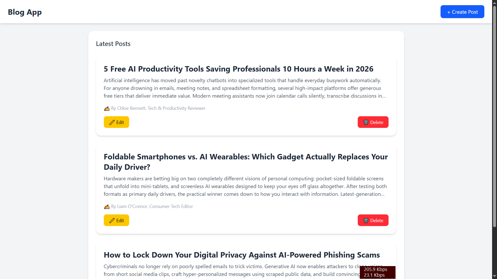
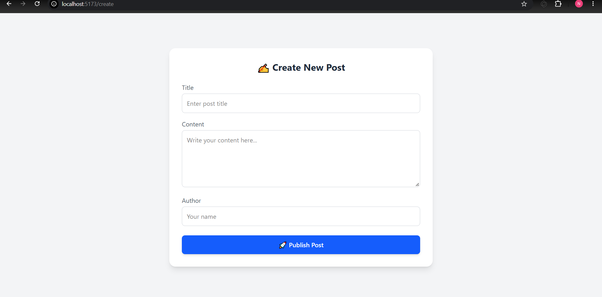
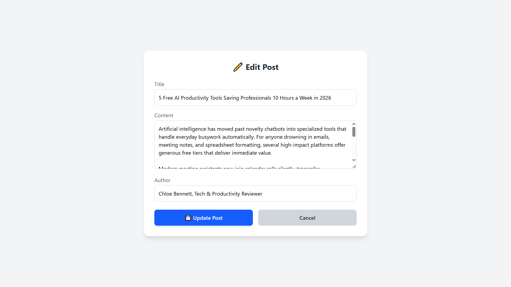

# 📝 Blog Application – Full Stack Web Project

A full-stack Blog Application that allows users to create, view, update, and delete blog posts. Built using React.js for the frontend and Java Spring Boot for the backend.

## 🚀 Project Overview

The Blog Application provides a simple interface to manage blog posts. It uses REST APIs to connect the React frontend with the Spring Boot backend.

## ✨ Features

- Create new blog posts
- View all available blog posts
- View individual blog posts
- Update existing blog posts
- Delete blog posts
- Responsive user interface
- REST API integration between frontend and backend

## 🛠️ Tech Stack

| Technology | Purpose |
|---|---|
| Java | Backend programming |
| Spring Boot | Backend framework |
| Spring Data JPA | Database interaction (if configured) |
| React.js | Frontend development |
| Axios | HTTP requests |
| React Router | Frontend navigation |
| Tailwind CSS | UI styling |
| Maven | Backend dependency management |
| Vite | Frontend development server |
| Git & GitHub | Version control |

## 📂 Project Structure

```text
Blog-Application/
│
├── backend/
│   ├── src/
│   │   └── main/
│   │       ├── java/
│   │       │   └── com/springboot/
│   │       │       ├── controller/
│   │       │       ├── entity/
│   │       │       ├── repository/
│   │       │       └── service/
│   │       │
│   │       └── resources/
│   │           └── application.properties
│   │
│   └── pom.xml
│
├── frontend/
│   ├── public/
│   ├── src/
│   │   ├── components/
│   │   ├── pages/
│   │   ├── services/
│   │   ├── App.jsx
│   │   └── main.jsx
│   │
│   └── package.json
│
├── .gitignore
└── README.md
```

## 🔗 REST API Endpoints

Base URL: `http://localhost:8080/api/posts`

| Method | Endpoint | Description |
|---|---|---|
| GET | `/api/posts` | Get all posts |
| GET | `/api/posts/{id}` | Get post by ID |
| POST | `/api/posts/create` | Create a post |
| PUT | `/api/posts/update/{id}` | Update a post |
| DELETE | `/api/posts/delete/{id}` | Delete a post |

## ⚙️ Installation & Setup

### Prerequisites

- Java JDK
- Maven
- Node.js and npm
- A configured database supported by the backend

### 1. Clone the Repository

```bash
git clone https://github.com/YOUR_USERNAME/blog-application.git
cd blog-application
```

### 2. Backend Setup

```bash
cd backend
```

Configure your database connection and credentials using environment variables in `application.properties`.

Run the Spring Boot application:

```bash
mvn spring-boot:run
```

Backend runs at:

`http://localhost:8080`

### 3. Frontend Setup

Open another terminal:

```bash
cd frontend
npm install
npm run dev
```

Frontend runs at:

`http://localhost:5173`

## 📸 Screenshots

Add screenshots of your application here.

### Home Page


### Create Post


### Edit Post


## 🔮 Future Improvements

- User authentication and authorization
- User registration and login
- Search and filter blog posts
- Pagination and sorting
- Rich text editor
- User-specific blog management
- Cloud deployment

## 👨‍💻 Author

**SHEKHAR SUMAN**

- GitHub: https://github.com/shekhar9199
- LinkedIn: https://www.linkedin.com/in/shekhar-suman18/

---

⭐ If you find this project useful, consider giving it a star!
